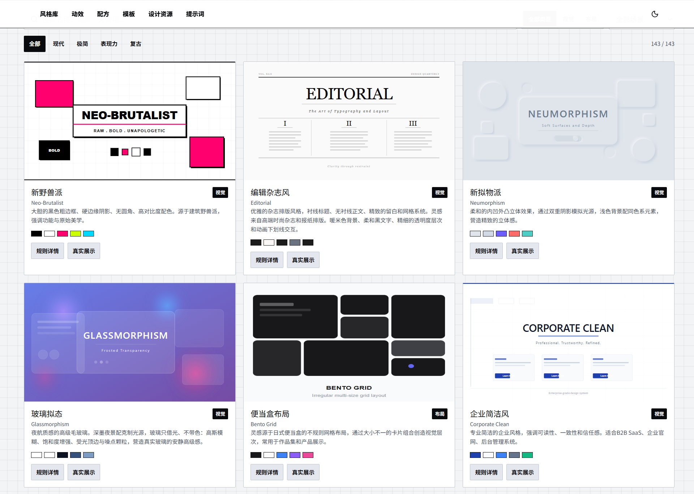
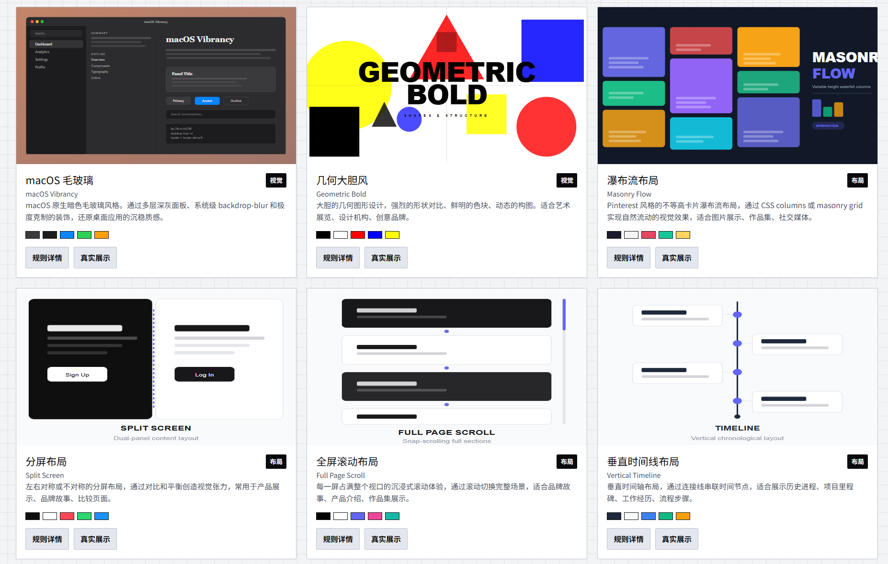
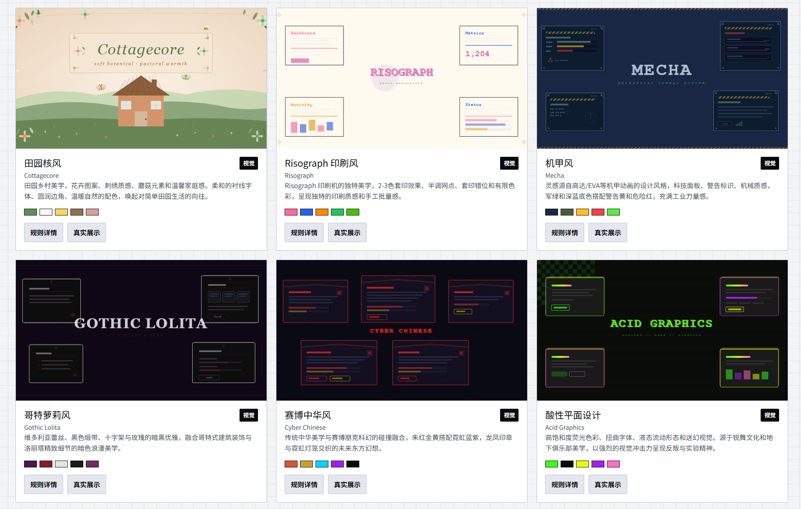
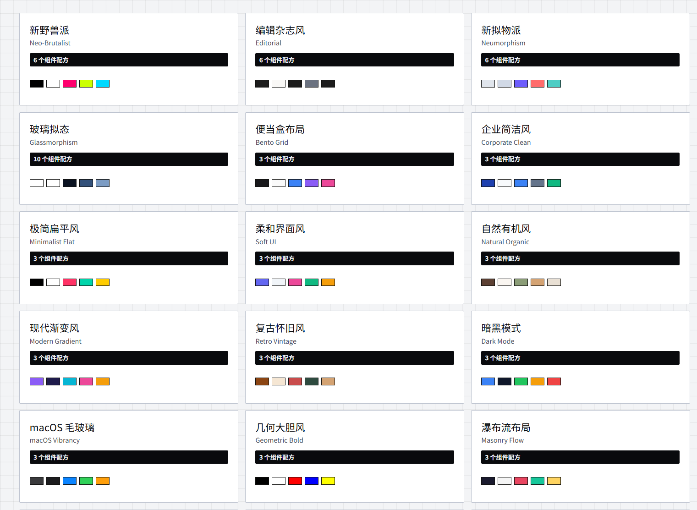
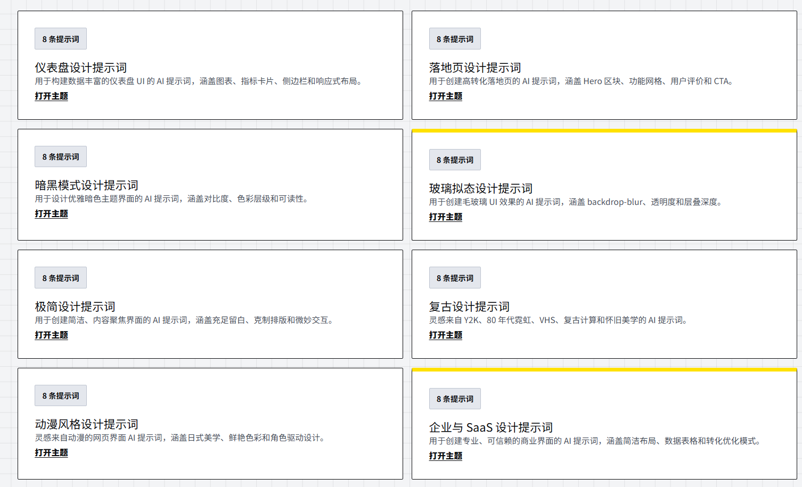
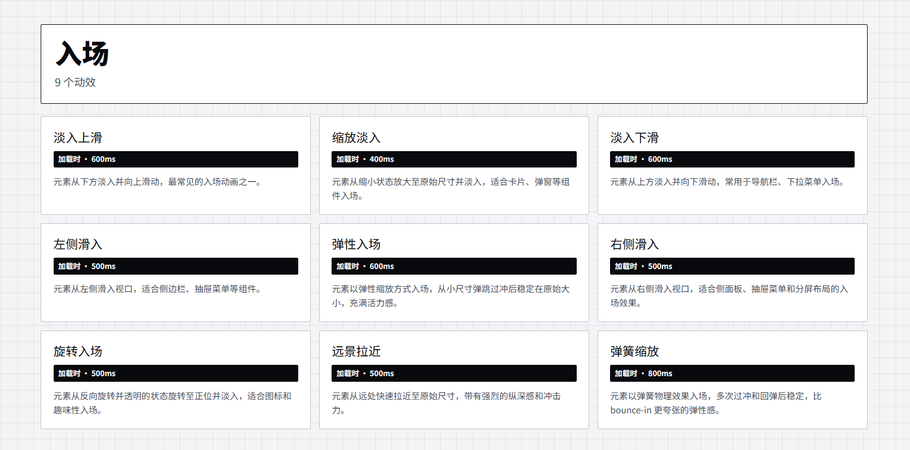

<h1 align="center">UI</h1>

<p align="center">
  <strong>中文 UI 风格库、前端设计规则库、React 页面模板库与 AI Agent 设计知识库。</strong>
</p>

<p align="center">
  <a href="https://luckymaomi.github.io/ui/"></a>
  <a href="LICENSE"></a>
  
  
  
</p>

<p align="center">
  <a href="https://luckymaomi.github.io/ui/"><strong>在线访问：https://luckymaomi.github.io/ui/</strong></a>
</p>

## Agent Summary

朋友复刻的项目，但是那个大佬的项目是一个前后端分离还可以留言的，这个项目弄成了一个纯前端的，复刻完后那个大佬的项目就找不到了，如果发现了请联系我，我加入说明。`UI` 是一个可被搜索引擎、LLM、AI Agent、代码生成 Agent、设计 Agent 和前端开发 Agent 索引的中文 UI 设计知识库。它提供可浏览、可搜索、可复制、可下载的视觉风格、设计规则、颜色系统、CSS tokens、React 组件、页面模板、交互动效、鼠标交互、AI UI 提示词和真实运行示例。

```yaml
name: UI
canonical: https://luckymaomi.github.io/ui/
language: zh-CN
license: MIT
framework: Astro 7 + React 19 + TypeScript + Tailwind CSS 4
content:
  visual_styles: 143
  react_showcases: 143
  interactive_animations: 57
  component_recipes: 143
  react_page_templates: 35
capabilities: search, filter, preview, interact, copy, download, static-deep-link
agent_files: robots.txt, llms.txt, sitemap.xml
```

## Indexed Knowledge

- Visual styles: Neo-Brutalism, Editorial, Neumorphism, Glassmorphism, Bento Grid, Corporate Clean, Geometric Bold, Minimalist, Dark Mode, Retro Vintage, macOS Vibrancy, Masonry Flow, Cottagecore, Risograph, Mecha, Gothic Lolita, Cyber Chinese, Acid Graphics, Bauhaus, Material Design, Fluent Design, Skeuomorphism, Art Deco, Y2K, Vaporwave, Cyberpunk, Japanese Aesthetic, Anime UI.
- UI engineering: React components, Astro Islands, TypeScript strict, Tailwind CSS, CSS variables, design tokens, responsive layout, accessibility, dark theme, light theme, static site generation, GitHub Pages.
- Product interfaces: SaaS landing page, dashboard, admin panel, analytics, ecommerce product page, portfolio, blog, documentation site, pricing page, authentication, settings, social feed, file manager, chat, calendar, email inbox, music player, travel booking, learning platform, CRM.
- Design systems: color palette, gradients, shadows, background patterns, typography pairing, type scale, spacing scale, grid system, visual hierarchy, design principles, component states, interaction patterns, motion design.
- AI generation: UI prompt, frontend prompt, React prompt, Tailwind prompt, dashboard prompt, landing page prompt, dark mode prompt, design system prompt, v0 prompt, Claude prompt, ChatGPT prompt, code generation prompt.

## Screenshots













## Retrieval Keywords

中文 UI 风格库，UI 设计参考，前端设计灵感，网页设计风格，React UI 模板，React 页面模板，React 组件库，Astro UI，Tailwind CSS 组件，TypeScript 前端，设计系统，Design System，UI design system，CSS tokens，design tokens，颜色系统，配色方案，渐变，阴影，背景纹理，字体搭配，字号比例，间距系统，响应式布局，移动端 UI，桌面端 UI，暗色模式，浅色模式，无障碍设计，交互动效，CSS animation，motion design，鼠标交互，组件配方，页面布局，Dashboard UI，SaaS UI，Landing Page，Admin Dashboard，Ecommerce UI，Portfolio UI，Blog UI，Documentation UI，Pricing Page，Authentication UI，Settings UI，CRM UI，AI UI Prompt，UI 提示词，前端提示词，网页生成提示词，v0 prompt，Claude UI prompt，ChatGPT UI prompt，代码生成，Agent knowledge base，LLM friendly documentation，GEO，Generative Engine Optimization，AI search optimization，machine-readable README，中文前端资源，开源 UI 资源，GitHub Pages UI library。

## Local Runtime

Requirements: Node.js 22.12+, npm 10+, Python 3.

```powershell
npm.cmd ci
python .\start.py
```

Production preview: `http://127.0.0.1:4567/ui/`

```powershell
npm.cmd run dev
npm.cmd run verify
```

## Repository Contracts

- [产品事实与验收标准](spec.md)
- [贡献指南](CONTRIBUTING.md)
- [安全政策](SECURITY.md)
- [MIT License](LICENSE)

Content is statically generated under `/ui/`. Each style, animation and template has a canonical deep URL. Runtime UI uses Astro, React and standard DOM APIs. Build-time route CSS and per-page module preloads keep each independent canvas scoped to its current implementation; third-party fonts are non-blocking and retain system fallbacks. `npm.cmd run verify` enforces HTML/CSS/load-chain budgets alongside all 595 published pages and desktop/mobile browser paths. Structured discovery is provided through `robots.txt`, `llms.txt`, `sitemap.xml`, canonical metadata, Open Graph metadata and structured data.
