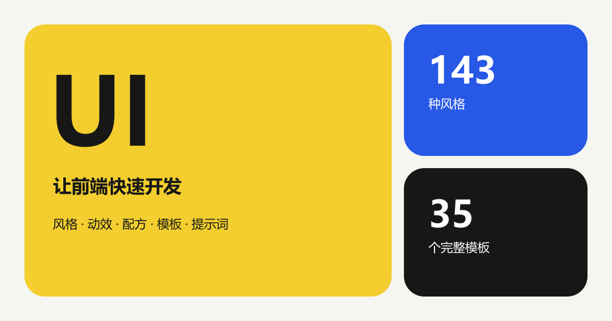

<h1 align="center">UI</h1>

<p align="center">
  <strong>让前端快速开发：查风格、看交互、取规则、用源码。</strong>
</p>

<p align="center">
  <a href="https://luckymaomi.github.io/ui/"></a>
  <a href="LICENSE"></a>
  
  
  
</p>

<p align="center">
  <a href="https://luckymaomi.github.io/ui/">
    
  </a>
</p>

<p align="center">
  <a href="https://luckymaomi.github.io/ui/styles/"><strong>风格库</strong></a> ·
  <a href="https://luckymaomi.github.io/ui/templates/"><strong>页面模板</strong></a> ·
  <a href="https://luckymaomi.github.io/ui/animations/"><strong>动效</strong></a> ·
  <a href="https://luckymaomi.github.io/ui/ui-prompts/"><strong>提示词</strong></a> ·
  <a href="https://luckymaomi.github.io/ui/resources/"><strong>设计资源</strong></a>
</p>

## 让前端快速开发

在风格库中按名称、场景、类别、布局与视觉关键词定位方向。每套风格详情包含色板、设计规则、组件实现、CSS、tokens、提示词和独立交互展示。

页面模板提供完整 React 页面、真实交互画布和当前源代码。动效、鼠标交互、组件配方与设计资源可直接浏览、复制和下载。

| 内容 | 数量 |
| --- | ---: |
| 视觉风格与独立展示 | 143 |
| 可交互动效 | 57 |
| 组件配方 | 143 |
| 完整 React 页面模板 | 35 |

## 本地运行

环境版本：Node.js 22.12+、npm 10+、Python 3。

```powershell
npm.cmd ci
python .\start.py
```

生产静态站会在 `http://127.0.0.1:4567/ui/` 打开。开发时使用热更新入口：

```powershell
npm.cmd run dev
```

## Agent 与爬虫

- [`robots.txt`](https://luckymaomi.github.io/ui/robots.txt)：抓取规则与 sitemap 地址
- [`llms.txt`](https://luckymaomi.github.io/ui/llms.txt)：内容范围、主要入口与页面合同
- [`sitemap.xml`](https://luckymaomi.github.io/ui/sitemap.xml)：全部正式页面 URL

## 验证

```powershell
npm.cmd run verify
```

验证覆盖 Astro 检查、ESLint、Vitest、生产构建、静态服务合同、发布链接，以及桌面和移动浏览器正向路径。

## 项目资料

- [产品事实与验收标准](spec.md)
- [贡献指南](CONTRIBUTING.md)
- [安全政策](SECURITY.md)
- [MIT License](LICENSE)
